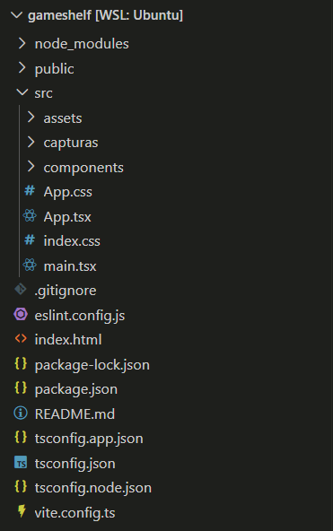
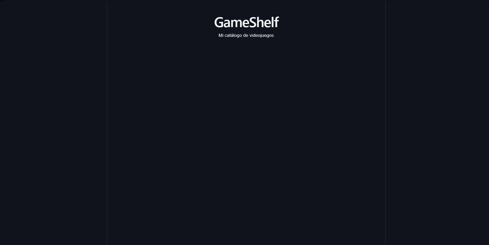
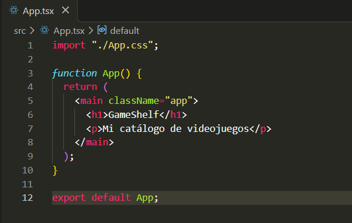
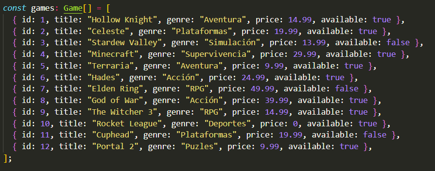
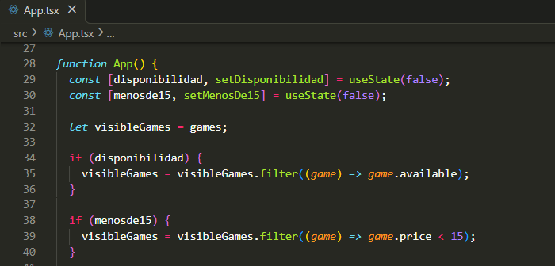
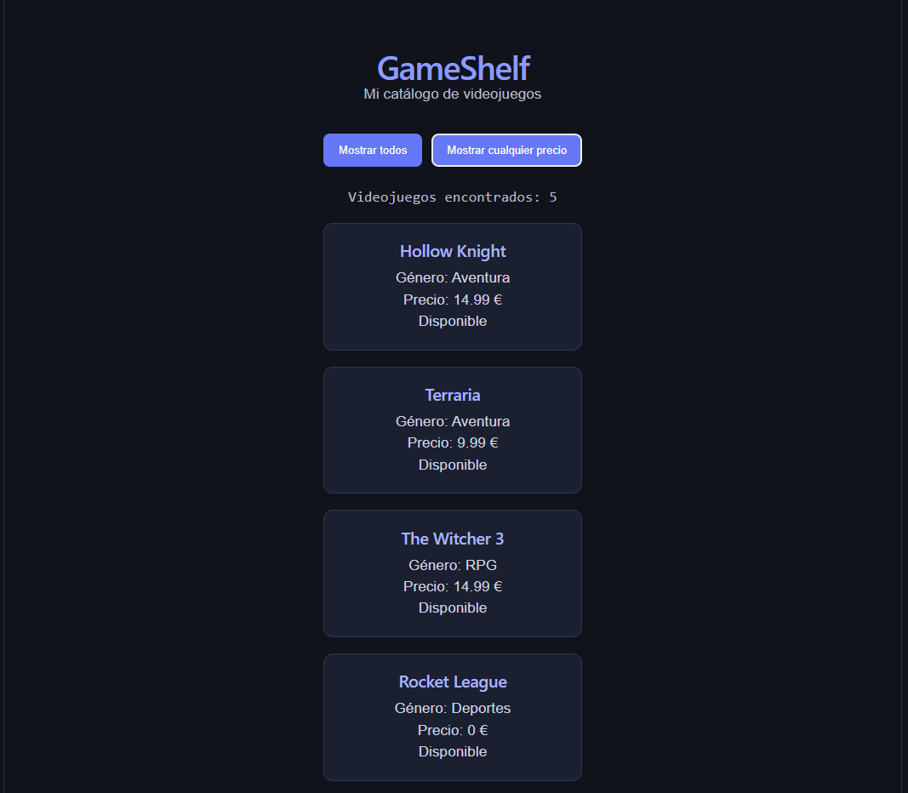
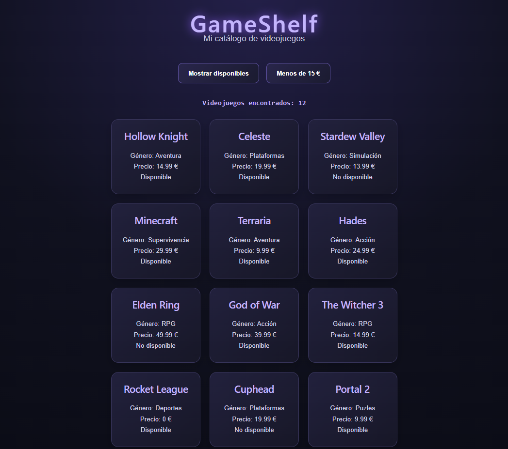
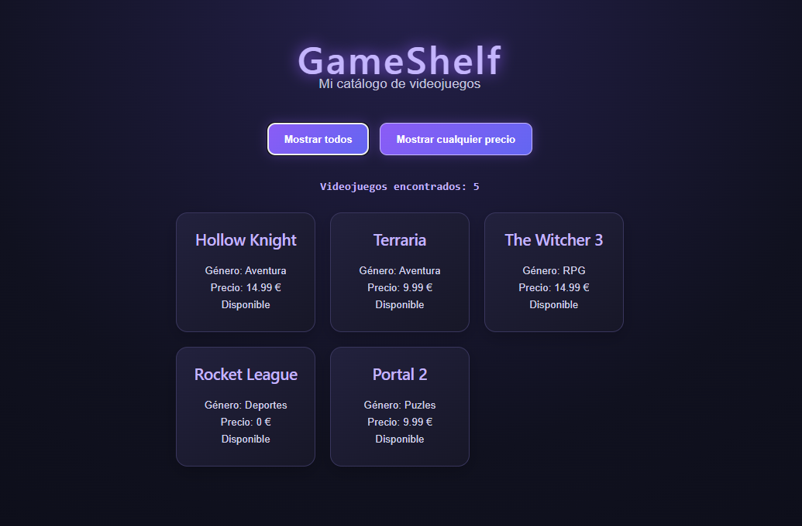

# GameShelf — Catálogo de Videojuegos
## 1. Introducción y Descripción del Proyecto
GameShelf es una aplicación web SPA (Single Page Application) desarrollada con **React, TypeScript y Vite**. El objetivo es tener como un catálogo digital interactivo donde los usuarios puedan visualizar videojuegos y filtrar las tarjetas por su disponibilidad y precio.

## 2. Herramientas Utilizadas y Flujo de Trabajo

### Requisitos Previos y Comprobación
*   **Node.js Versión:** v24.21.0
*   **npm Versión:** 11.19.0

### Comandos de Ejecución Utilizados
Primero creo el proyecto con este comando `npm create vite@latest gameshelf -- --template react-ts`. Seguidamente entramos al gameshelf `cd gameshelf` y instalamos las dependencias con `npm install`. Y por ultimo lanzamos el proyecto con `npm run dev`.

## 3. Bloque de Investigación

### Preguntas sobre la Arquitectura del Entorno
*   **¿Qué es React? ¿Es un lenguaje, una biblioteca o una herramienta?**  

    React es una biblioteca de JavaScript que sirve para crear el diseño y la experiencia visual de páginas web y aplicaciones.

    *Fuente:* https://react.dev/learn/your-first-component
*   **¿Qué diferencia hay entre `create-vite` y `Vite`? ¿Qué hace Vite mientras ejecutamos `npm run dev`?¿Qué crees que hará `npm run build`?**  

    Create-vite es el asistente de inicio y Vite es el motor principal.

    Vite, cuando se ejecuta `npm run dev`, arranca un servidor local super rápido, le envia al navegador solo lo que necesita ver y cada vez que guardas un cambio se aplica sin tener que recargar la pagina.

    Y `npm run build` limpia y comprime el codigo, eliminando lo que no sirve para que pese menos. Después traduce para el navegador y genera una carpeta con archivos super optimizados, listos para subirse a internet.

    *Fuente:* https://vite.dev/guide/
*   **¿Qué son Node.js y npm? ¿Para qué usamos npm create, npm install y npm run dev?**  
    Node.js es el entorno de ejecución necesario en tu máquina para poder utilizar su sistema. Y `npm` es el gestor de paquetes que interactúa con este entorno para ejecutar comandos e instalar herramientas. 

    `npm create` se utiliza para inicializar y descargar una plantilla limpia para comenzar la estructura del proyecto rápidamente. El `npm install` se usa para descargar de forma local herramientas, librerías, etc... que el proyecto necesite para funcionar bien. Y por ultimo `npm run dev` se usa para ejecutar el script interno mapeado en los archivos de configuracion para encender el servidor de Vite.

    *Fuente: https://vite.dev/guide/*
*   **¿Qué son las dependencias? ¿Por qué aparece node_modules?**  
    Son librerias, paquetes o herramientas de codigo abierto que necesita el proyecto obligatoriamente para compilarse y funcionar bien. Aparece node_modules porque se genera automaticamente cuando ejecutas el comando de instalacion de paquetes.

    *Fuente:* (https://vite.dev/guide/)
*   **¿Qué añade TypeScript a JavaScript?**  
    Pues TypeScript es completamente tipado y estricto.

    *Fuente:* https://vite.dev/guide/
*   **¿Qué significan JSX y TSX?**  
    JSX es una extension sintáctica de React que te deja poner etiquetas html dentro del propio codigo.
    TSX es la combinacion de JSX pero aplicada dentro de archivos de código que adoptan y soportan el tipado estricto de TypeScript.

    *Fuente:* https://react.dev/learn y https://vite.dev/guide/

## 4. Investigación de la Estructura de Archivos

| Archivo / Carpeta | Pregunta de investigación | Función en el Proyecto (Con mis palabras) |
| :--- | :--- | :--- |
| `index.html` | ¿Qué elemento tiene `id="root"`? | Un 
 vacío donde se inyecta toda la app de React |
| `src/main.tsx` | ¿Qué componente importa? ¿Dónde aparece `createRoot`? | Importa App. createRoot conecta React con el HTML real |
| `src/App.tsx` | ¿Qué interfaz se muestra? | La vista y el contenido principal de la página web |
| `src/App.css` | ¿Qué reglas visuales aparecen? | Estilos de diseño exclusivos para el componente App|
| `src/index.css` | ¿En qué se diferencia de `App.css`? | Estilos globales para toda la web |
| `package.json` | ¿Qué comandos aparecen en `scripts`? | Comandos clave como dev y build |
| `tsconfig.json` | ¿Qué indica “ts”? ¿Necesitas editarlo hoy? | Indica TypeScript. No hace falta editarlo hoy |
| `vite.config.ts` | ¿Qué nombre de herramienta aparece? | Vite, el empaquetador y servidor rápido del proyecto |
| `public/` y `src/assets/` | ¿Qué recursos encuentras? | Archivos estáticos como imágenes, logos e iconos |
| `node_modules/` | ¿Qué contiene? ¿Por qué no se sube? | Librerías instaladas. No se sube porque es muy pesado. |
| `.gitignore` | ¿Qué archivos o carpetas ignora Git? | Archivos que no se deben subir |

## 5. Glosario de Conceptos de Programación

- **Componente:** Es una parte de la página web. En mi proyecto, `GameCard` muestra cada videojuego.

- **Props:** Son los datos que recibe un componente, como el título, el precio o el género.

- **Función vs Llamada:** Definir una función es escribirla y llamarla es ejecutarla.

- **Parámetro `game` en `map()`:** Contiene un videojuego diferente en cada vuelta de la lista.

- **Función Flecha en `map()`:** Devuelve una tarjeta con los datos de cada videojuego.

- **Manejador de Eventos (`onClick`):** Sirve para ejecutar una acción cuando pulso un botón.

- **Estado (`useState`):** Guarda valores que pueden cambiar y permite que React actualice la pantalla.

- **Métodos `map()` y `filter()`:** `map()` crea las tarjetas y `filter()` selecciona los juegos que cumplen una condición.

- **El atributo `key`:** Sirve para que React pueda distinguir cada videojuego de la lista.

## 6. Diseño y Estilos (CSS)

- **Uso de `className`:** En JSX usamos `className` en vez de `class` porque es la forma que utiliza React para asignar clases a los elementos.

- **Estrategia de diseño:** Escribí los estilos en `App.css`. Usé las clases `.app`, `.catalog` y `.card` para organizar los videojuegos y cambiar los colores, los bordes y los espacios.

## 7. Desarrollo del Catálogo y Filtros Dinámicos
*   **Estrategia de ampliación:** Conservé los 3 juegos base (`Hollow Knight`, `Celeste`, `Stardew Valley`) y añadí 9 juegos más. He verificado que los IDs sean únicos y los precios numéricos no lleven comillas.
*   **Lógica de filtros y mini-reto:** Uso `visibleGames` para guardar los juegos que se muestran. Primero filtro los disponibles y después los que cuestan menos de 15 €. Así puedo combinar los dos filtros sin modificar la lista original.

## 8. Capturas

### A. Estructura del proyecto en VS Code

### B. Primera pantalla de GameShelf (Paso inicial)

### C. Código fuente y catálogo ampliado

### D. Filtro de disponibilidad activo y precio

### E. Resultado final

### F. Mejora CSS

## 9. Reflexión y Resolución de Problemas

**1. ¿Qué archivo conecta el HTML con App?**

El archivo `main.tsx`, que carga el componente `App` en la página.

**2. ¿Qué diferencias hay entre React, TypeScript y Vite?**

React sirve para crear la página, TypeScript para comprobar los tipos de datos y Vite para ejecutar el proyecto.

**3. ¿Qué son las props de GameCard?**

Son los datos que recibe cada tarjeta, como el título, el género, el precio y la disponibilidad.

**4. ¿Por qué usamos setOnlyAvailable para cambiar el estado?**

Porque permite cambiar el filtro y hacer que React actualice la pantalla.

**5. ¿Qué hacen map() y filter()?**

`map()` crea las tarjetas de los juegos y `filter()` selecciona los que cumplen una condición.

**6. ¿Para qué sirve key?**

Sirve para que React pueda identificar cada videojuego de la lista.

**7. ¿Qué error te costó más resolver y cómo lo solucionaste?**

Lo que más me costó fue hacer que los dos filtros funcionaran juntos. Lo solucioné aplicando primero el filtro de disponibilidad y después el del precio.
