# Pokédex con JavaScript

En esta actividad se ha ampliado la anterior práctica guiada (pre-pokedex) para completar y hacer mucho más completa mi pokedex.

Utilizo **HTML, CSS y JavaScript**  y gracias a la **PokéAPI** podemos obtener la información de los pokemon.

La versión final permite consultar los 151 Pokémon y ofrece diferentes funcionalidades como búsqueda, cambio de sprite e información ampliada.

# 1. Punto de partida

## 1.1. Práctica guiada anterior

En esta práctica se creó una aplicación para poder consultar un Pokémon mediante su nombre o número y mostrar su información básica.

Utilizo:

- HTML para la estructura.
- CSS para el diseño.
- JavaScript para la funcionalidad.
- `fetch()` para realizar peticiones a PokéAPI.
- `async` y `await` para trabajar con peticiones asíncronas.
- `try` y `catch` para gestionar errores.

La práctica guiada utilizaba esta estructura:

```text
mini-pokedex/
├── README.md
├── index.html
├── assets/
│   └── img/ 
├── css/
│   └── style.css
└── js/
    └── app.js
```

---

## 1.2. Funcionamiento inicial

En la anterior práctica intoduces el nombre o número de un Pokémon y haces una consulta a la PokéAPI.

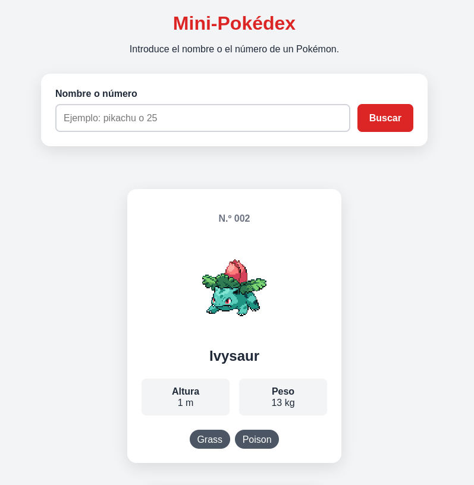

La tarjeta muestra:

- Número del Pokémon.
- Nombre.
- Imagen.
- Altura.
- Peso.
- Tipo o tipos.

## 1.3. Prueba de error

También se comprobó el comportamiento de la aplicación cuando se introduce un Pokémon inexistente.

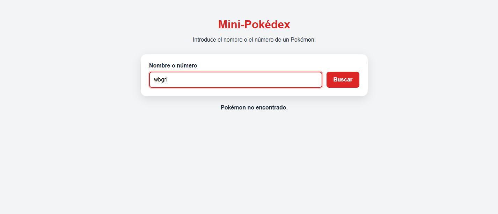


## 1.4. Funcionalidades que ya estaban implementadas

En la práctica anterior ya estaban las siguientes funcionalidades:

- Buscar Pokémon por nombre.
- Buscar Pokémon por número.
- Normalizar la búsqueda.
- Consultar PokéAPI.
- Mostrar una tarjeta.
- Mostrar imagen.
- Mostrar número.
- Mostrar nombre.
- Mostrar altura.
- Mostrar peso.
- Mostrar tipos.
- Mostrar un mensaje de carga.
- Gestionar Pokémon inexistentes.

**Commit:** 92e0a6d56f8fdf808a39834fc58dd19b855c6754

# 2. Preparación del proyecto

La estructura pasó a ser:

```text
pokedex/
├── index.html
├── README.md
├── assets/
│   └── images/
├── css/
│   └── style.css
└── js/
    ├── app.js
    └── Pokemon.js
```

# 3. Consulta de PokéAPI

## 3.1. Primera petición

Primero comprobé cómo funcionaba una petición a PokéAPI utilizando `fetch()`.

La dirección utilizada fue:

```text
https://pokeapi.co/api/v2/pokemon/${id}
```

Utilicé `async` y `await` para esperar la respuesta de la API.

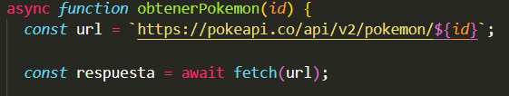

# 4. Creación de `Pokemon.js`

Este archivo se encarga de representar los datos que voy a utilizar de cada Pokémon.

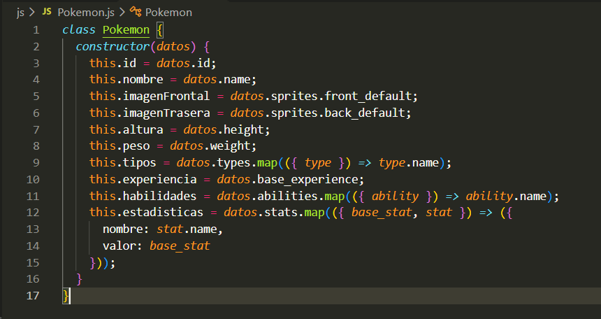

No guardo toda la información de la respuesta de PokéAPI, solo la información que necesita la aplicación.

# 5. Carga de los 151 Pokémon

Para obtener los Pokémon desde el número `1` hasta el `151`.

Utilicé un bucle `for` para realizar las peticiones:

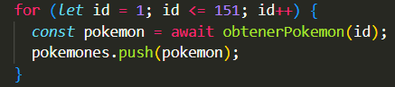

Mientras se realiza la carga aparece el mensaje:

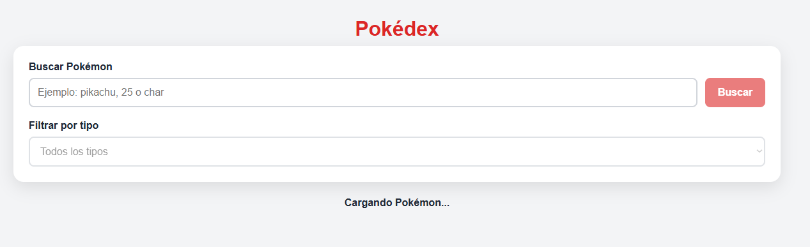

Cuando termina la carga se muestran los 151 Pokémon.

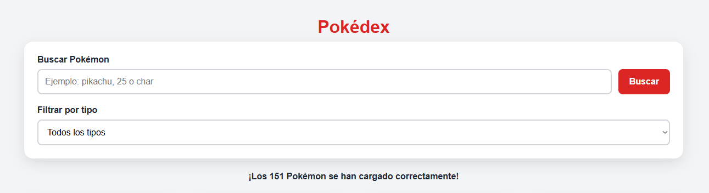

# 6. Creación de las tarjetas

Cuando se cargaron los Pokémon, modifiqué `app.js` para generar las tarjetas.

Cada tarjeta muestra:

- Número.
- Nombre.
- Imagen.
- Altura.
- Peso.
- Tipo o tipos.
- Botón `Ver detalles`.

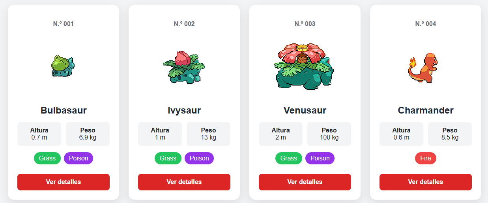

### Conversión de unidades

PokéAPI da la altura y el peso en unidades diferentes a las que necesitamos mostrar.

Por eso hice las conversiones necesarias:

```javascript
pokemon.altura / 10
```

para obtener la altura en metros.

Y:

```javascript
pokemon.peso / 10
```

para obtener el peso en kilogramos.

# 7. Cambio de sprite

Lo nuevo que se ha pedido para esta tarea esque se viera el pokemon de espaldas y que al pasar el cursor salga por delante y cuando lo quites que vuelva a verse desde atras.

Para hacerlo usé:

```javascript
mouseenter
```

y:

```javascript
mouseleave
```

Este es el codigo donde lo uso:

```javascript
tarjeta.addEventListener("mouseenter", function () {
  const imagen = tarjeta.querySelector(".pokemon__imagen");

  imagen.src = pokemon.imagenFrontal;
});
```

Y para volver al sprite de atras:

```javascript
tarjeta.addEventListener("mouseleave", function () {
  const imagen = tarjeta.querySelector(".pokemon__imagen");

  imagen.src = pokemon.imagenTrasera;
});
```

| Sin el cursor: | Con el cursor: |
|---|---|
| 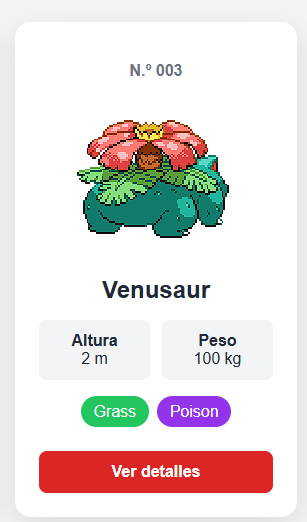 | 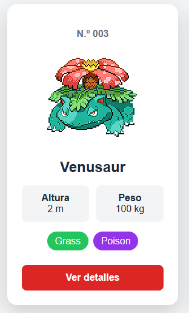 |

# 8. Barra de búsqueda

Aqui amplié la búsqueda de la práctica anteior para que deje buscar de diferentes formas.

### Búsqueda por nombre

Ejemplo:

```text
pikachu
```

Resultado esperado:

```text
Pikachu
```

### Búsqueda por número

Ejemplo:

```text
25
```

Resultado esperado:

```text
Pikachu
```

### Búsqueda por fragmento

Ejemplo:

```text
char
```

Esto muestra los pokemon que contengan ese fragmento.

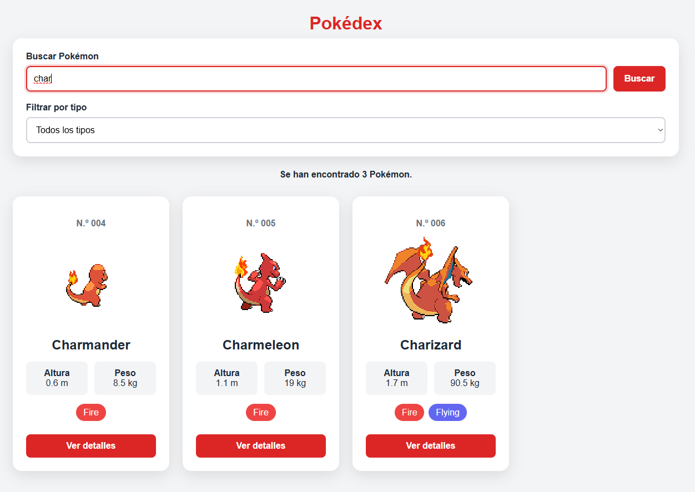

### Mayúsculas y espacios

También utilizo:

```javascript
trim()
```

y:

```javascript
toLowerCase()
```

para quitar los espacios que no hagan falta y hacer que de igual si se escriben mayúsculas o minúsculas.

# 9. Filtro por tipo

Puse para la busqueda un filtro para poder filtar los Pokémon por tipo. Las opciones del filtro no están escritas a mano, lo que hice es obtenerlos de los pokemon que devuelve la API.

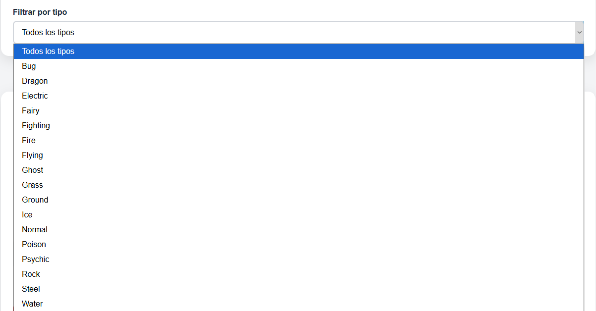

Por ejemplo al seleccionar `Fire`, solo aparecen los Pokémon que tienen ese tipo.

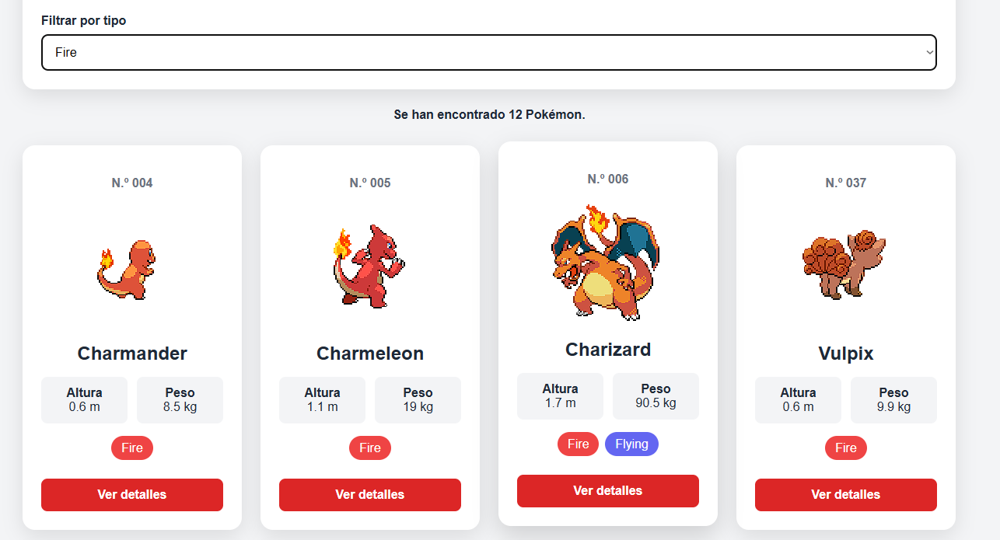

# 10. Combinación de búsqueda y filtro

Se puede usar la búsqueda y el filtro al mismo tiempo

Por ejemplo:

```text
Búsqueda: char
Tipo: fire
```

La aplicación solamente muestra los Pokémon que cumplen las dos condiciones.

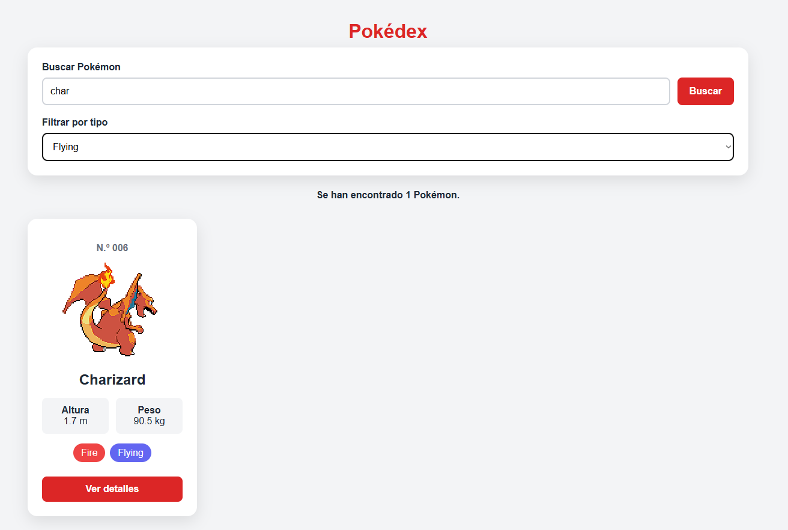

Para que funcione el filtro compruebo:

```javascript
const coincideNombre = pokemon.nombre.includes(texto);
```

y:

```javascript
const coincideTipo = pokemon.tipos.includes(tipo);
```

Y después compruebo que las dos condiciones se cumplan.

# 11. Información ampliada

Seguidamente añadí un botón:

```text
Ver detalles
```

a cada una de las tarjetas.

Al al darle aparece una ventana con más información del Pokémon.

La ventana muestra:

- Nombre.
- Número.
- Imagen de delente.
- Tipos.
- Altura.
- Peso.
- Experiencia.
- Habilidades.
- Estadísticas.

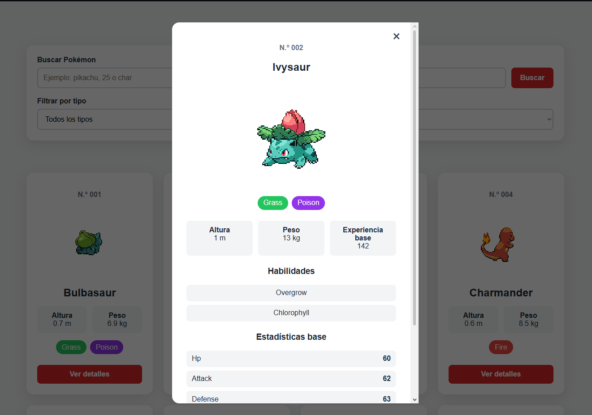

# 12. Habilidades

En el panel de detalles se muestran las habilidades obtenidas mediante:

```javascript
pokemon.habilidades
```

Estas habilidades las obtengo de la información que da la PokéAPI.

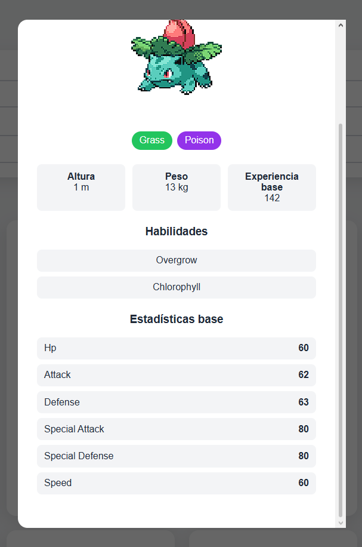

# 13. Estadísticas

También se muestran las estadísticas del Pokémon.

Las estadísticas incluidas son:

- HP.
- Attack.
- Defense.
- Special Attack.
- Special Defense.
- Speed.

La información se consigue de:

```javascript
pokemon.estadisticas
```


# 14. Cerrar los detalles

El panel de detalles se puede cerrar pulsando la "x" arriba a la derecha o también pulsando fuera de la tarjeta. Para eso utilicé:

```javascript
modal.remove();
```

# 15. Gestión de errores

La aplicación también controla posibles errores cuando se comunique con la PokéAPI. En el caso que haya un error se muestra:

```text
Ha ocurrido un error al cargar los Pokémon. Inténtalo de nuevo.
```

Además, aparece un botón:

```text
Reintentar
```

que te deja volver a cargar.

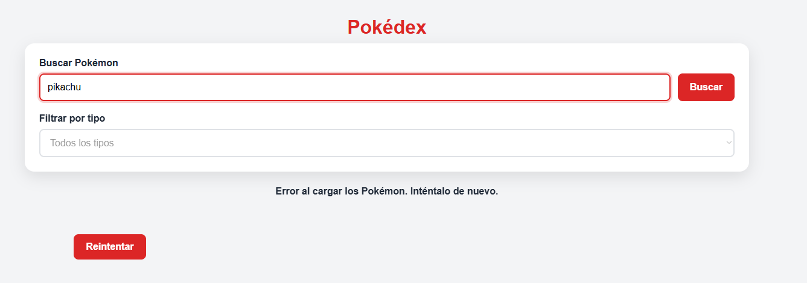

# 16. Diseño responsive

Modifiqué el CSS para que las tarjetas se adapten a diferentes tamaños de pantalla.

```css
@media (max-width: 900px) {
  .resultado {
    grid-template-columns: repeat(3, 1fr);
  }
}
```

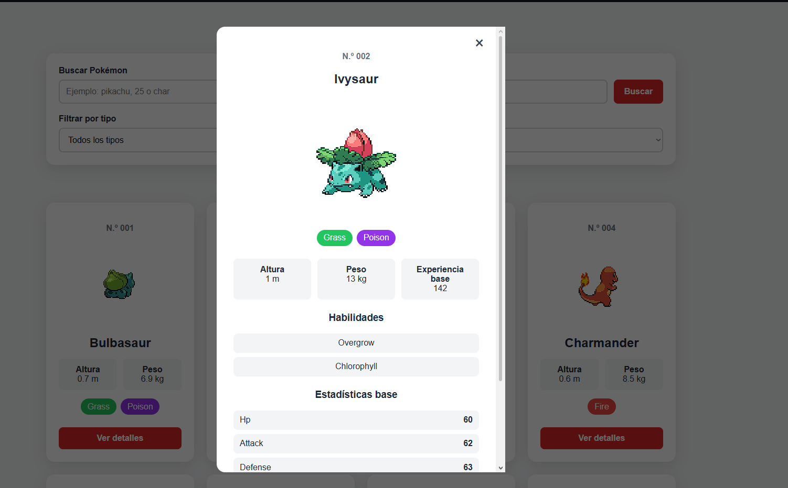

Y para el móvil:

```css
@media (max-width: 480px) {
  .resultado {
    grid-template-columns: 1fr;
  }
}
```

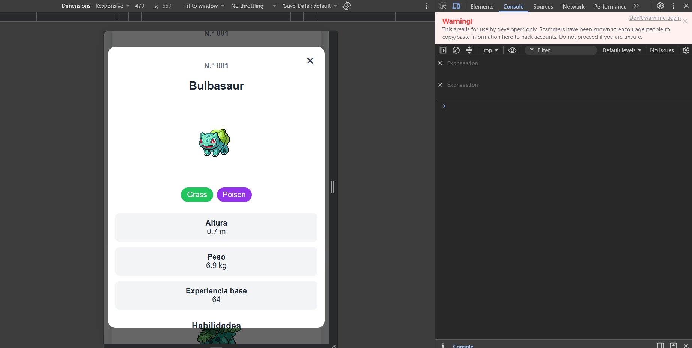
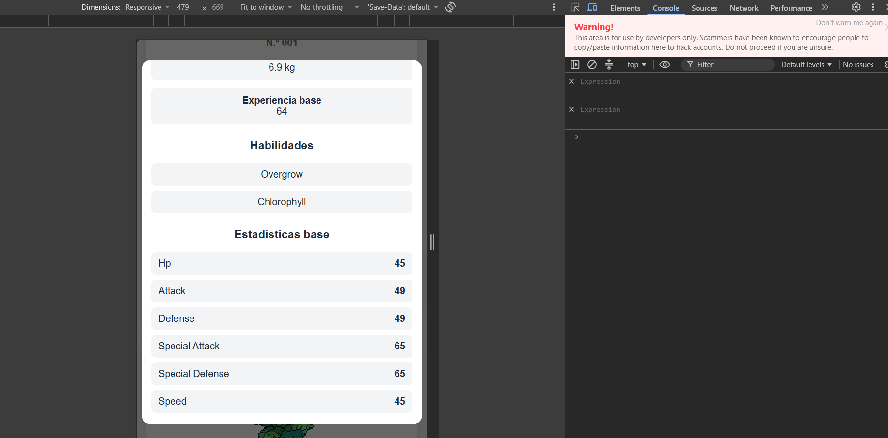

# 17. Modificaciones finales

Finalmente he cambiado el css para que sea mucho más visual y bonito y también he añadido animación a los pokemon con css

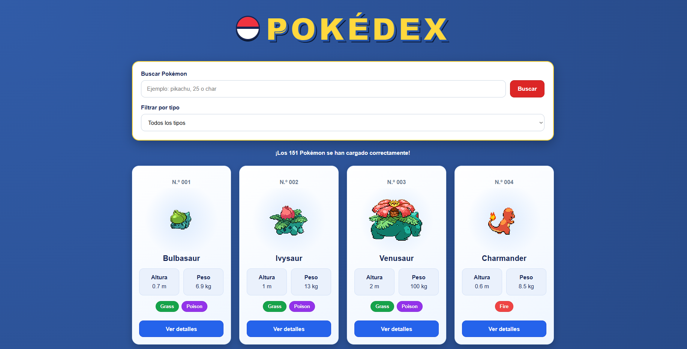
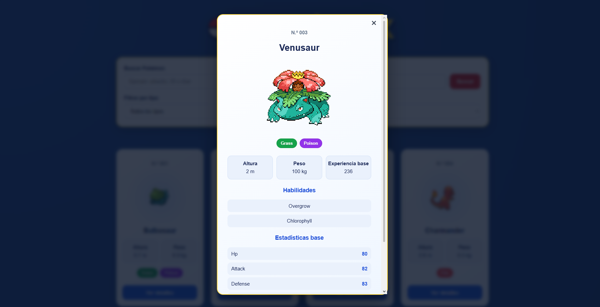

## 18. Tecnologías utilizadas

- HTML
- CSS
- JavaScript
- PokéAPI
- GitHub

## 19. Conclusiones

Con esta actividad he ampliado la mini-Pokédex de la práctica anterior y la he convertido en una aplicación que muestra los 151 Pokémon.

Durante el desarrollo he practicado principalmente:

- Peticiones mediante `fetch()`.
- Funciones `async` y `await`.
- Trabajo con JSON.
- Arrays y objetos.
- Clases en JavaScript.
- Eventos.
- Manipulación del DOM.
- Generación dinámica de HTML.
- Filtros y búsquedas.
- Gestión de errores.

### Dificultades encontradas

Las dificultades que he tenido ha sido sobretodo en el codigo de javaScript porque han habido cosas que no he sabido hacer y las he tenido que buscar como se hacen y entender su funcionamiento. Lo bueno esque lo que he hecho aqui, pues se me han quedado bastantes cosas nuevas que he aprendido.

### Posibles mejoras

Pues se podrían poner los pokemon que más te gusten añadirlos a favorito. Poner mas información, por ejemplo, los movimientos que tengan, evoluciones, etc....También que se puedan comparar estadisticas de un pokemon con otro. Y hasta poder filtrar por mas de un tipo o buscar por sus estadisticas.


