# Dossier de React Native con Expo y Android Studio

### Práctica 1. Hola mundo
Creación del proyecto inicial con Expo y desarrollo de una pantalla básica utilizando `View` y `Text` centrados con Flexbox sobre fondo rosa.

### Práctica 2. Contador con dos botones
Implemento un estado con `useState` para un contador con dos botones (`Button`) para incrementar y decrementar su valor dentro de un contenedor.

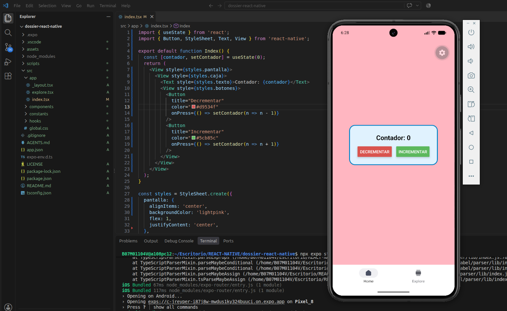

### Práctica 3. InicioScreen y estilos separados
Separo las pantallas en la carpeta `src/screens/` (`HolaMundoScreen.tsx` e `InicioScreen.tsx`) y extraigo todos los estilos mediante `StyleSheet.create()`.

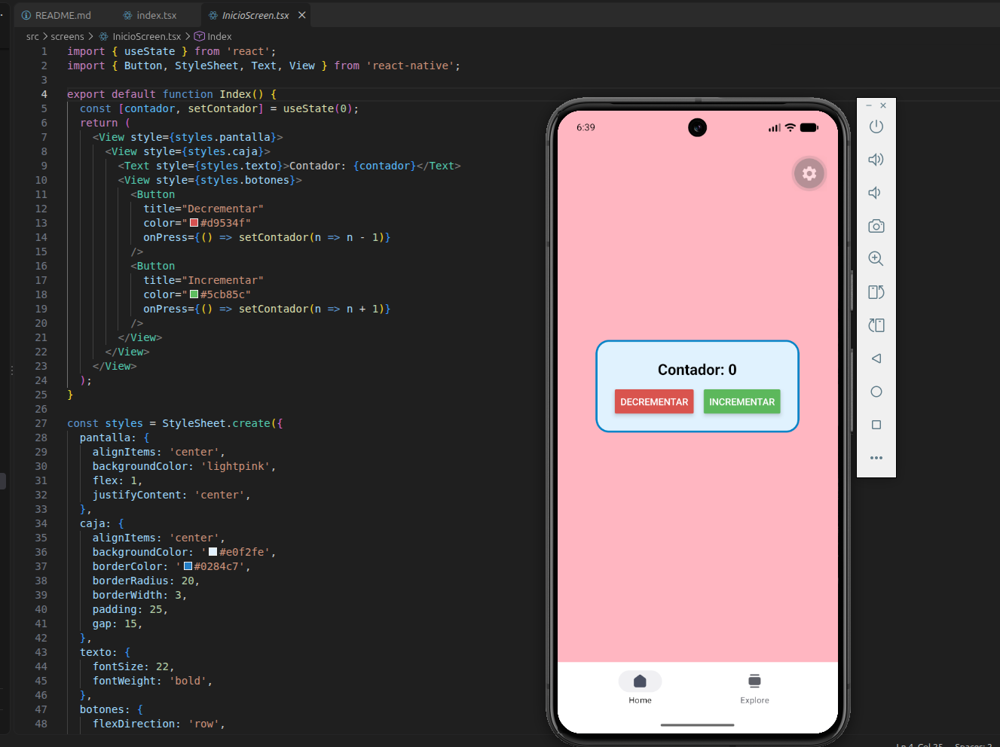

### Práctica 4. Tres cajas
Creo el componente `Caja.tsx` en TypeScript y renderizo tres cajas de 100×100 dentro de un contenedor con `flex: 1`.

### Práctica 5. Modificar flex dinámicamente
Uso los estados independientes para modificar la propiedad `flex` de cada caja con botones de incremento y decremento, repartiendo el espacio disponible en la pantalla.

### Práctica 6. Sustituir los botones
Sustituyo los botones por `TouchableHighlight` (mostrando una alerta al incrementar) y `TouchableOpacity` (al decrementar) para mejorar el aspecto visual.

### Práctica 7. Nombre y estilos personalizados
Amplío el componente de caja para recibir estilos externos mediante `StyleProp<ViewStyle>` y aplico bordes y esquinas personalizadas a las cajas.

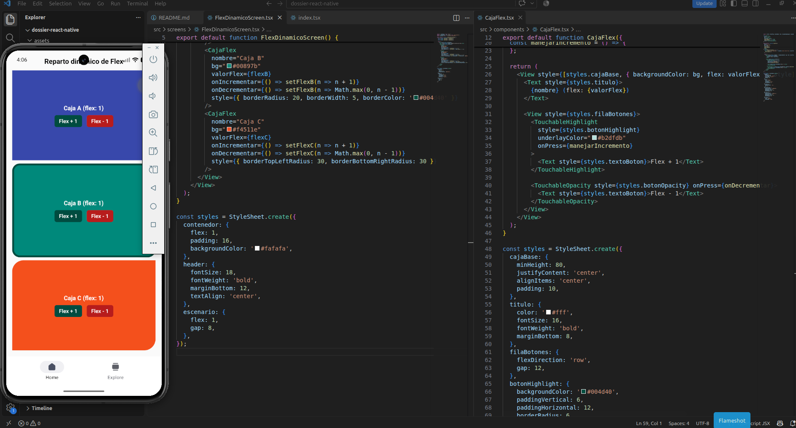

### Práctica 8. Círculos dinámicos
Genero círculos con colores RGB aleatorios y controles táctiles para alternar entre `flexWrap` (`wrap`/`nowrap`) y `flexDirection` (`row`/`column`).
Añado circulos:

Con nowrap:
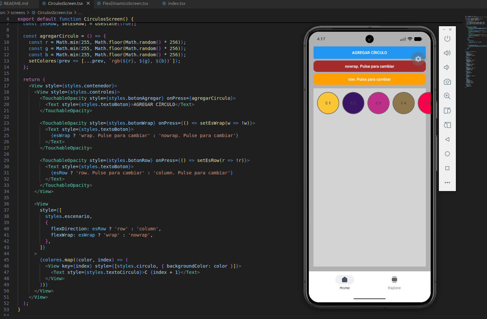
En Column:
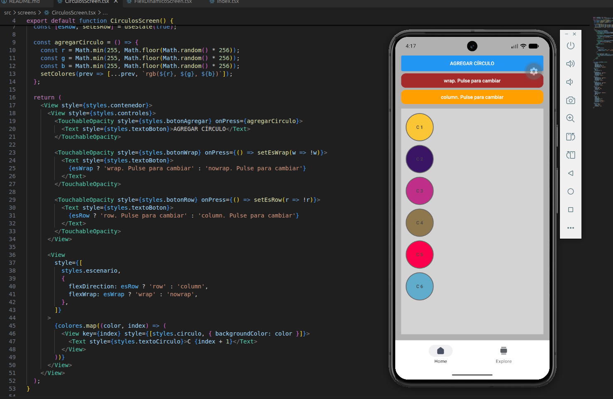

### Práctica 9. Distribución, alineación e imágenes
Tengo control dinámico de `justifyContent` mediante un `TextInput` validado y de `alignItems` con botones, distribuyendo tres imágenes.

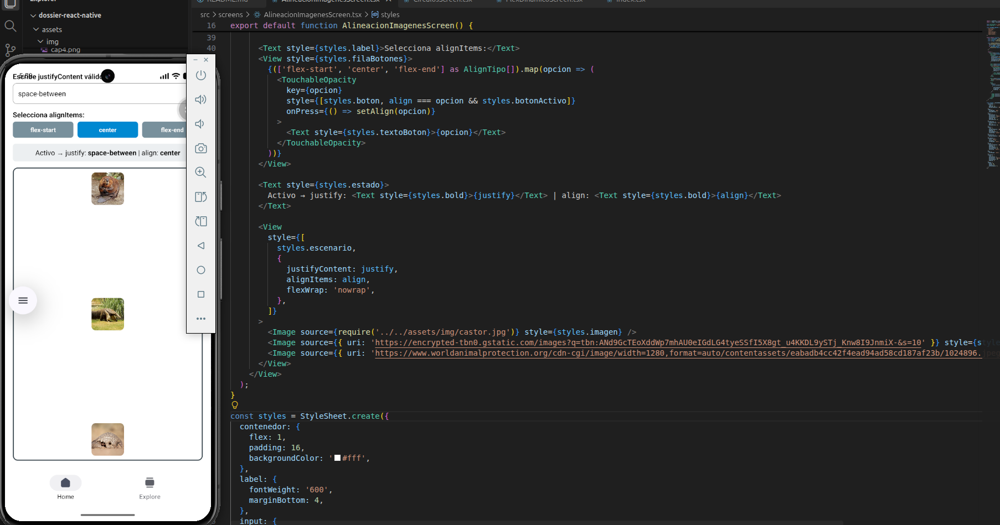

### Práctica 9.1. Imagen aleatoria
Se eligen imagenes aleatorias locales definidas en una colección estática mediante `Math.random()` y se actualiza en pantalla usando `useState`.

### Práctica 10. Calculadora
Desarrollo una calculadora funcional utilizando `SafeAreaView`, botones (`TeclaCalculadora.tsx`), distribución por filas con Flexbox y operaciones gestionadas mediante estados sin usar `eval()`.

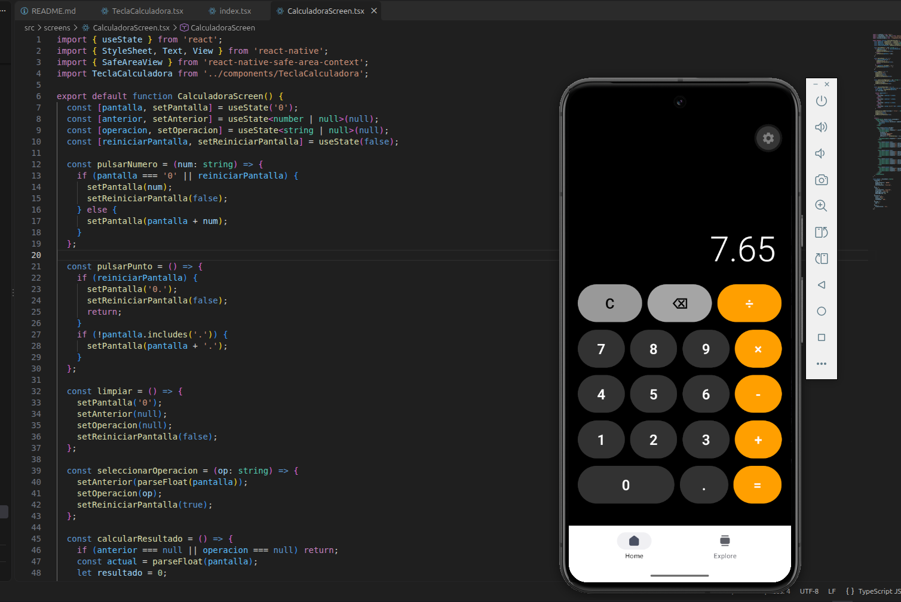

### Práctica 11. Hook personalizado para la calculadora
Extraigo las variables y toda la lógica de la calculadora a un hook (`src/hooks/useCalculadora.ts`) y separo el funcionamiento interno de la interfaz gráfica y reutilizo `TeclaCalculadora.tsx`.

### Práctica 12. Color aleatorio con confirmación
Creo una pantalla con un botón que selecciona un color aleatorio de un array y solicita confirmación mediante `Alert.alert()`. Si el usuario pulsa «Aceptar», se actualiza el estado del color de fondo y si cancela, se mantiene el anterior.

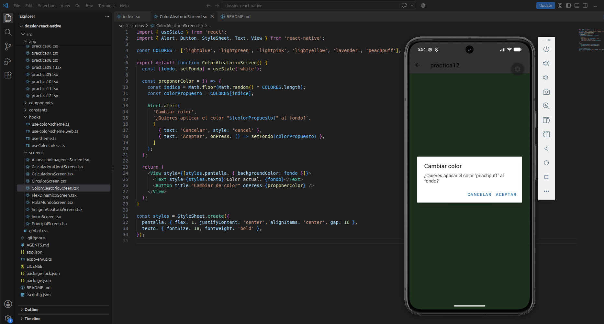
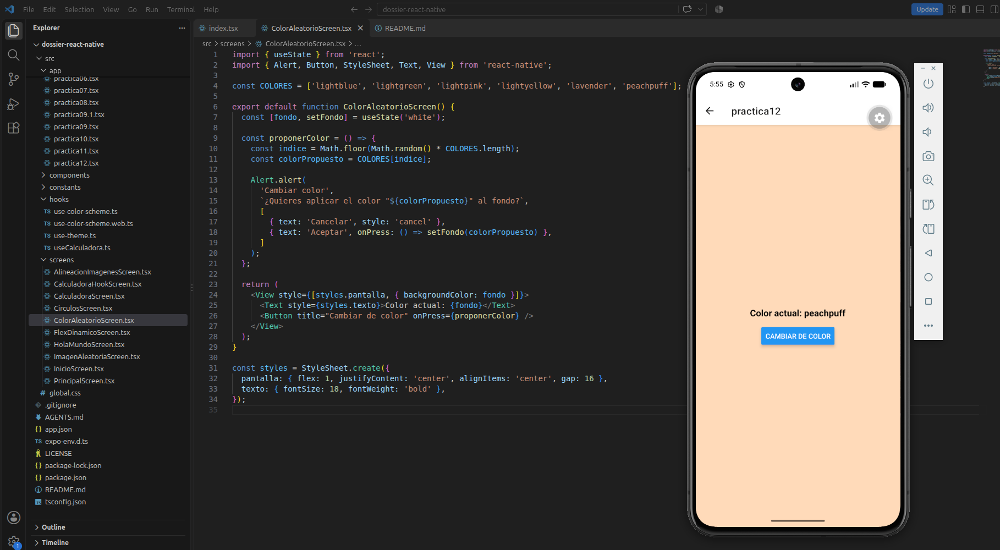

### Práctica 13. Introducir el color
Creo una pantalla en la que puedes escribir un color. Si el usuario pulsa «Aceptar» y el valor es válido (comprobado con `processColor()`), se actualiza el fondo de la pantalla; si cancela o el color no es válido, se mantiene el anterior.

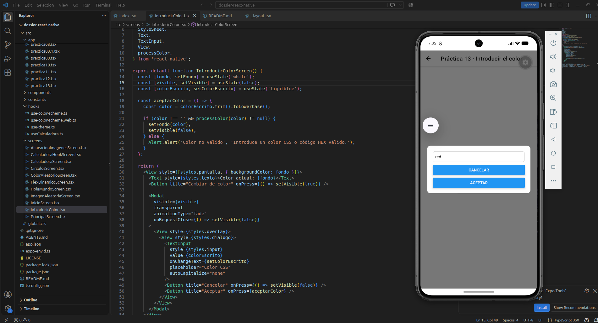
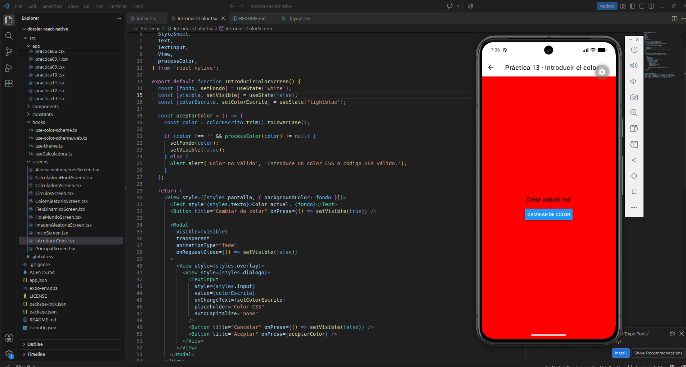

### Práctica 14. Borde activado por Switch
Creo una pantalla con un control `Switch` y el indicador (`thumbColor`) es marrón cuando está desactivado y naranja cuando está activado. Al activarlo aparece un borde rojo alrededor de la pantalla, y al desactivarlo desaparece.

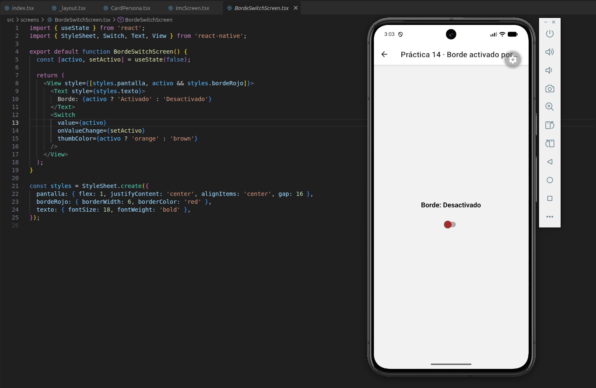
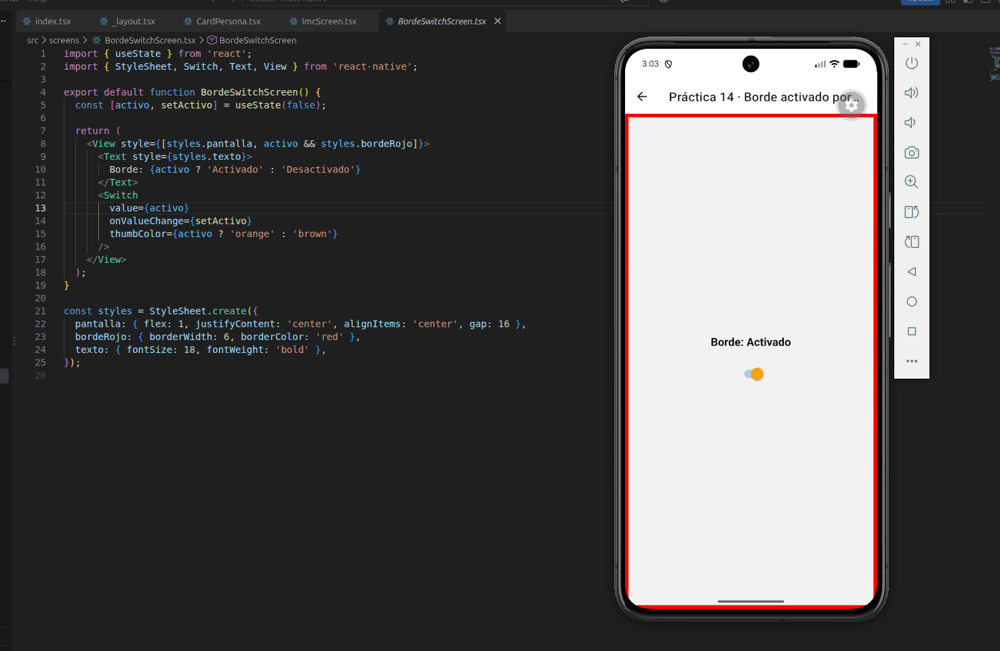

### Práctica 15. Completar el formulario
Creo un formulario controlado con `useState` para recoger el nombre, la edad, si está casado y si está jubilado, actualizo cada campo mediante la función `cambiarCampo`. Al pulsar «Enviar», se valida que el nombre no esté vacío y que la edad sea numérica antes de mostrar el resumen final en pantalla.

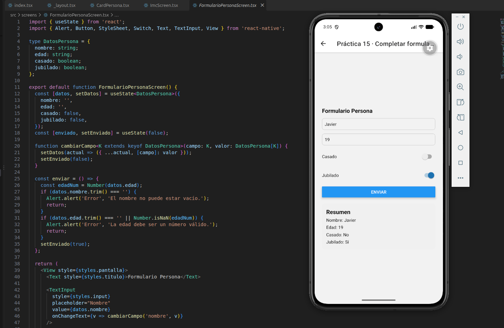

### Práctica 16. Lista de productos
Creo una pantalla que utiliza `FlatList` para mostrar un listado de productos con su nombre, precio y stock, sin separadores entre elementos. Se emplea el índice (`index % 2`) en `renderItem` para alternar el color de fondo entre filas pares e impares, junto con una cabecera centrada y de mayor tamaño («Lista Productos»).

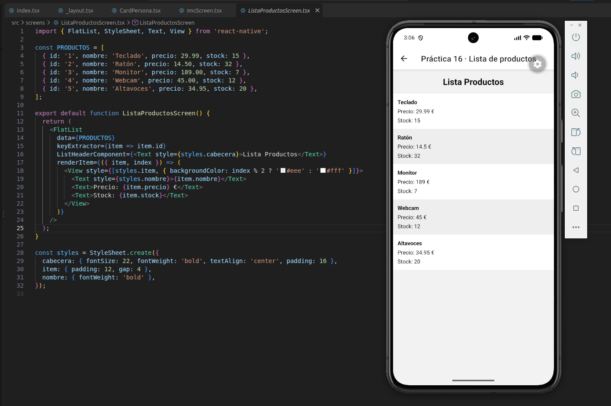

### Práctica 17. Tarjetas para calcular el IMC
Creo el componente `CardPersona.tsx` con los campos de nombre, altura y peso para calcular automáticamente el IMC validando que no se divida entre cero. En la pantalla se gestiona una lista de identificadores con un botón «+» para añadir nuevas tarjetas y un botón en cada tarjeta para eliminarla mediante una función recibida por `props`.

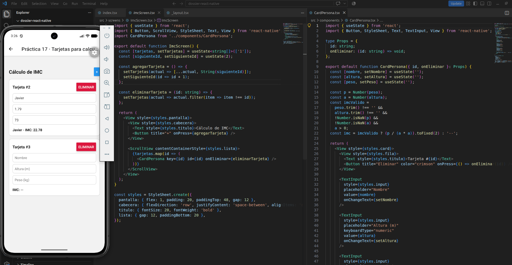

### Práctica 18. Diario de emociones
Creo el componente `DiarioEmocionesScreen.tsx` con un `TextInput`, un botón y un `FlatList` para mostrar el historial de entradas almacenadas en un estado de tipo array. Al guardar, registro la fecha y hora exacta con segundos (`toLocaleTimeString()`) y evalúo el texto con `.includes()` para asignar dinámicamente un icono sonriente (`:-)`), triste (`:-(`) o neutral.

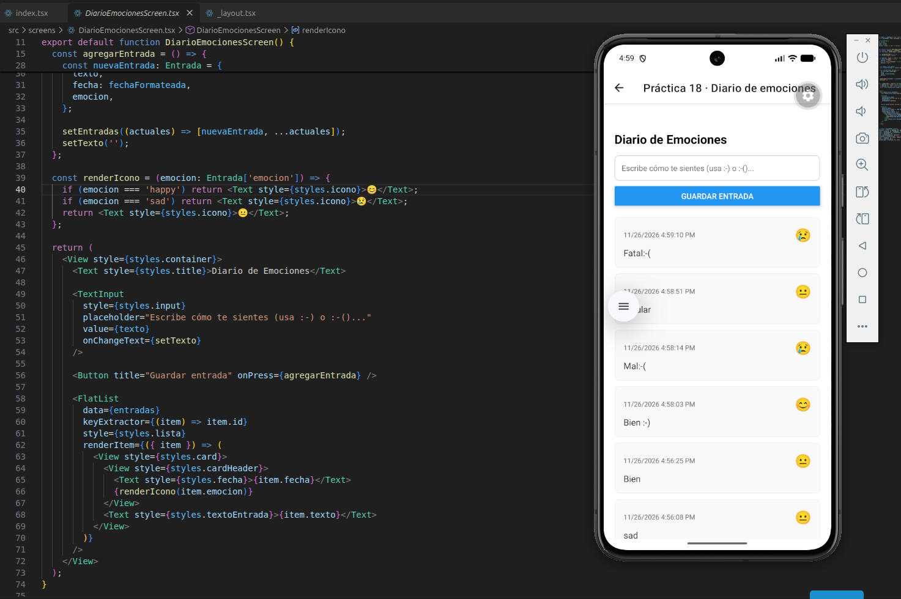

### Práctica 19. Insertar emoticonos en el texto
Creo la pantalla `InsertarEmoticonosScreen.tsx` con una barra superior de botones táctiles (`TouchableOpacity`) encima de un `TextInput` controlado. Al pulsar cada icono, concateno su secuencia de texto correspondiente al final del contenido actual utilizando la actualización funcional del estado `setTexto((actual) => actual + emoji)`.

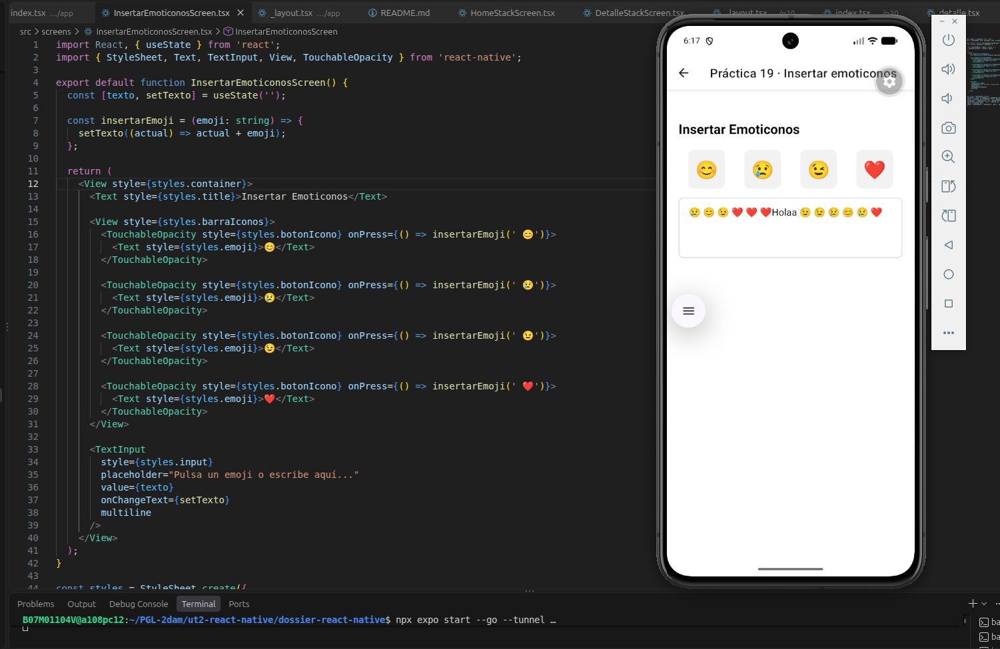

### Práctica 20. Primer Stack
Organizo las pantallas en la carpeta `src/app/stack/p20/` definiendo un navegador `Stack` en su propio `_layout.tsx` y manteniendo `src/app/index.tsx` intacto como índice general. Desde la pantalla principal (`index.tsx`) navego hacia `detalle.tsx` mediante el componente `<Link>` y regreso a la pantalla anterior utilizando `router.back()`.

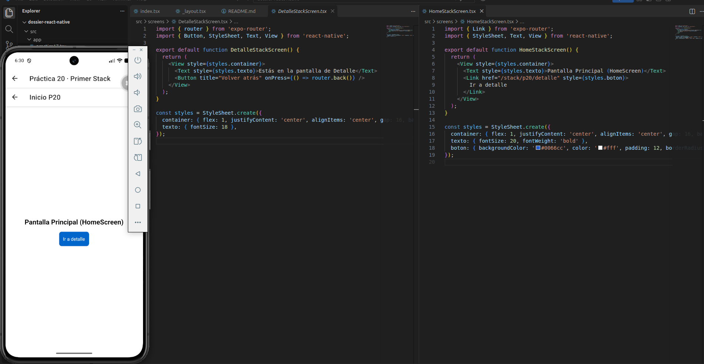
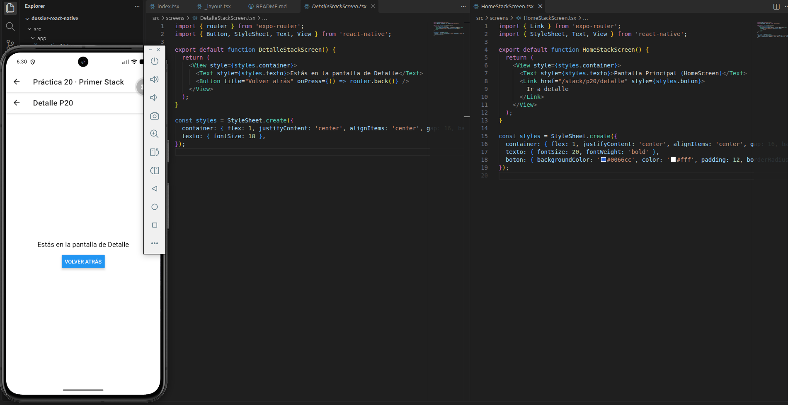

### Práctica 21. Stack con tres pantallas
Configuro `Stack` en `src/app/stack/p21/` con tres pantallas (`index.tsx`, `segunda.tsx` y `tercera.tsx`). Utilizo `router.push()` para navegar entre ellas enviando el parámetro `userName` en el objeto `params`, el cual recupero y muestro en la tercera pantalla mediante el hook `useLocalSearchParams()`.

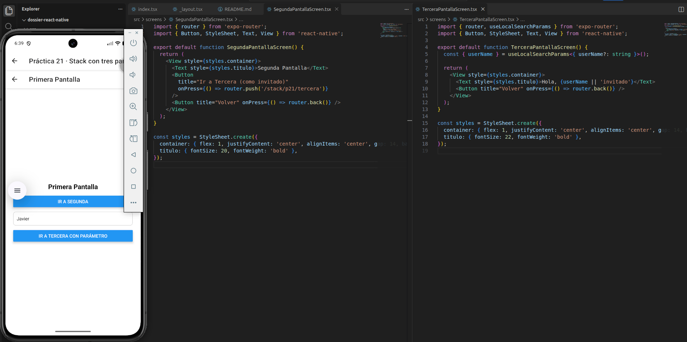
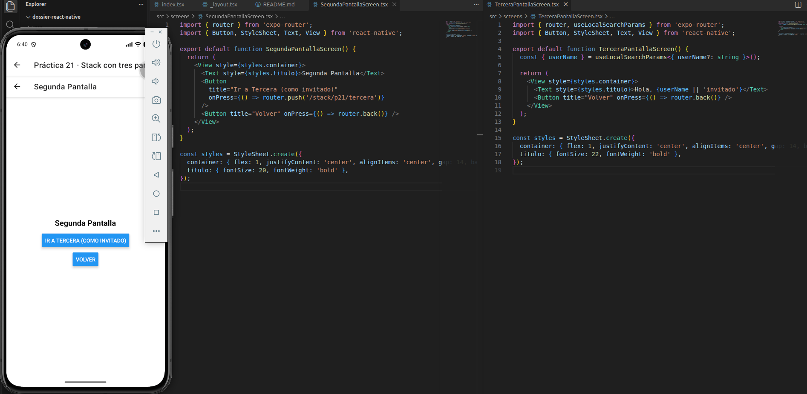
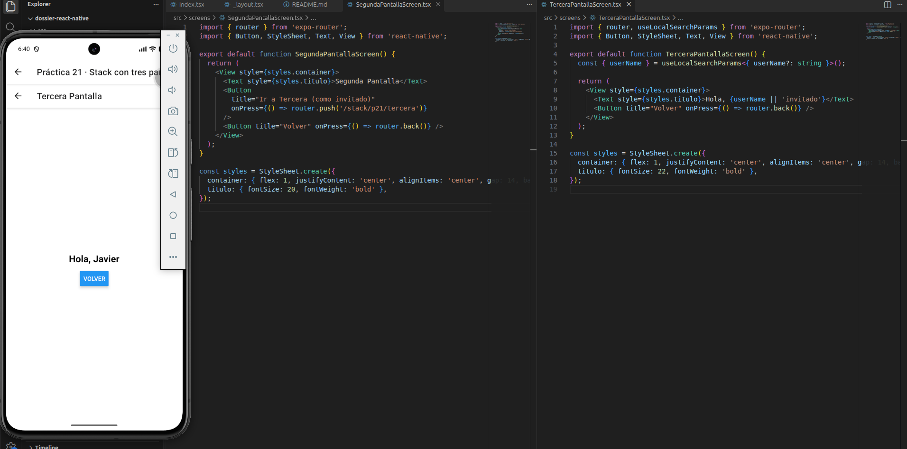