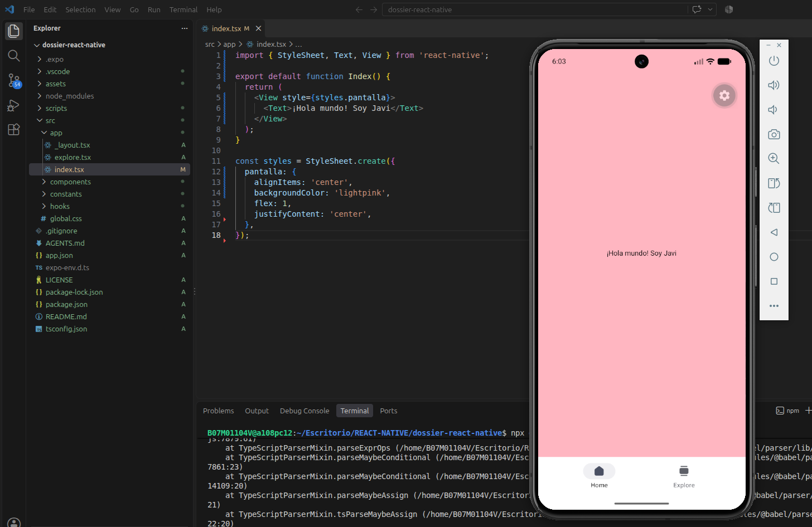
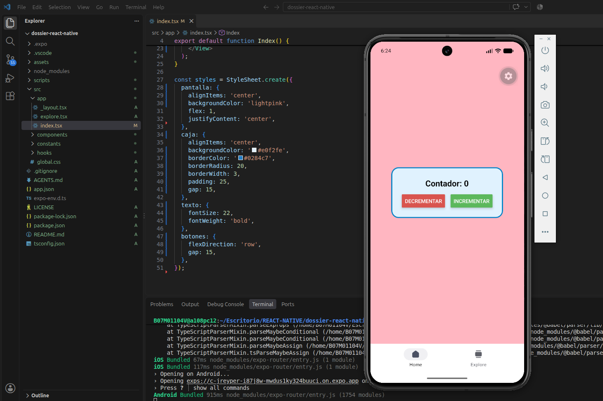
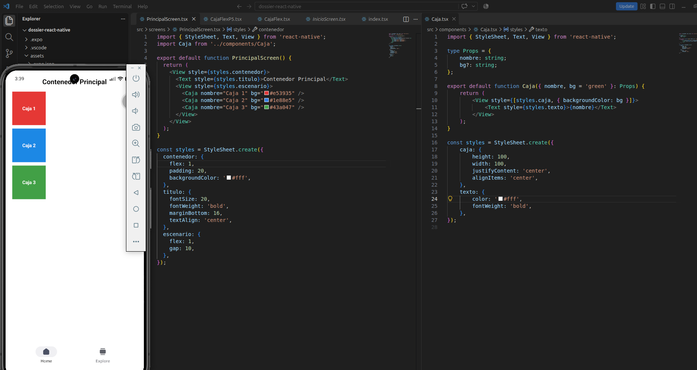
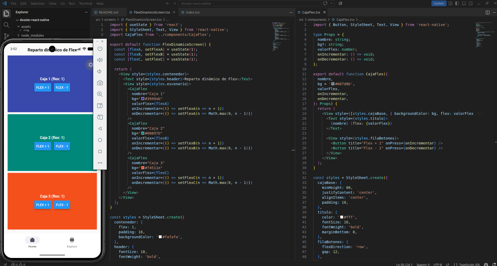
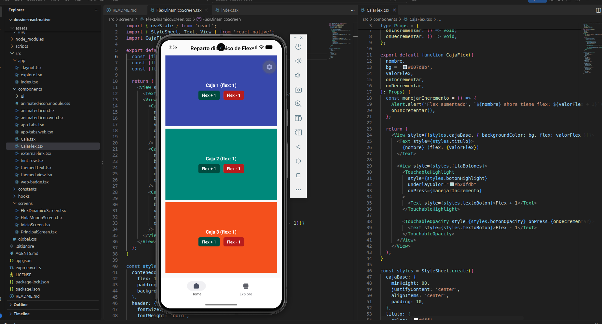
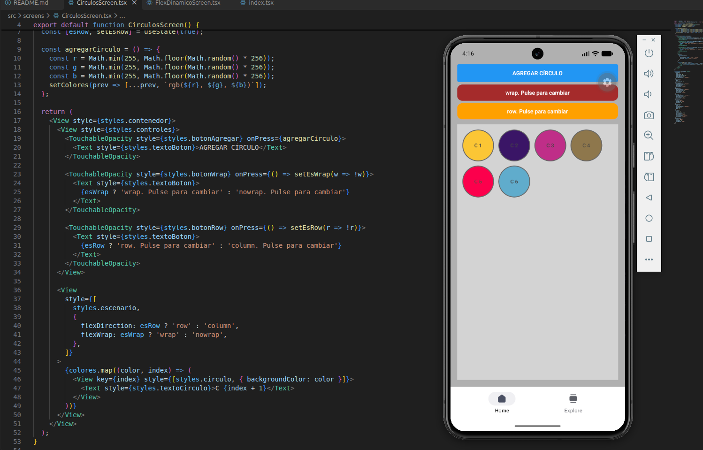
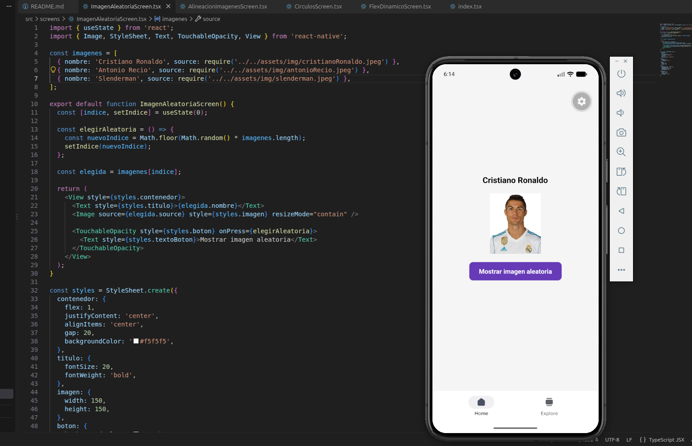
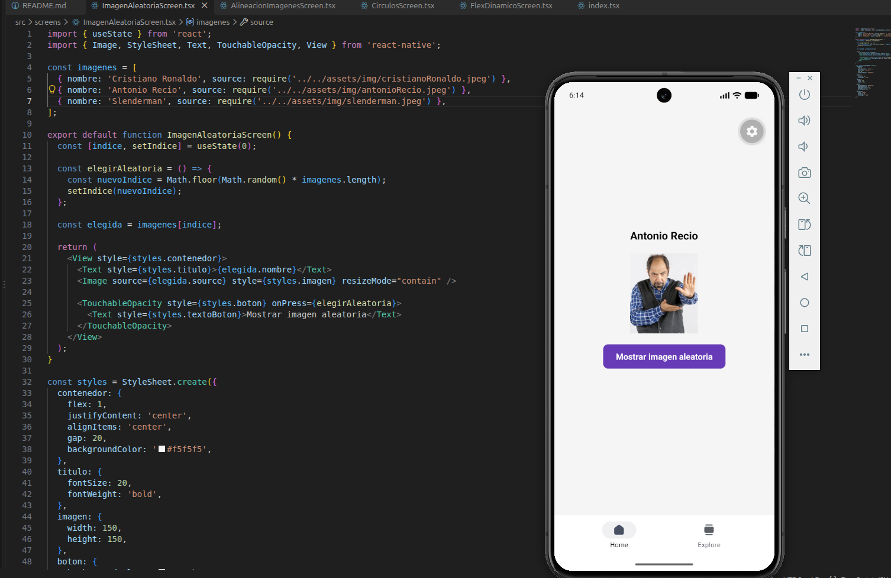
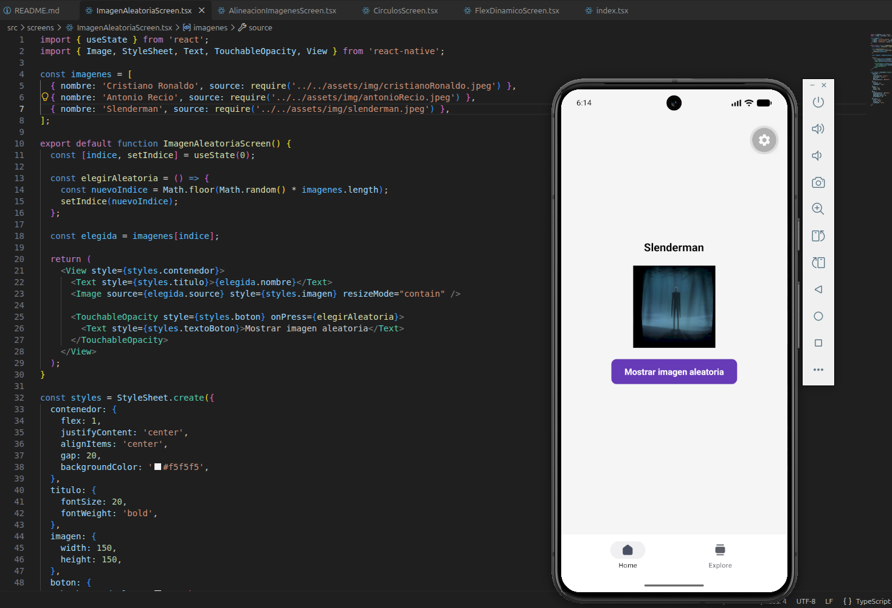
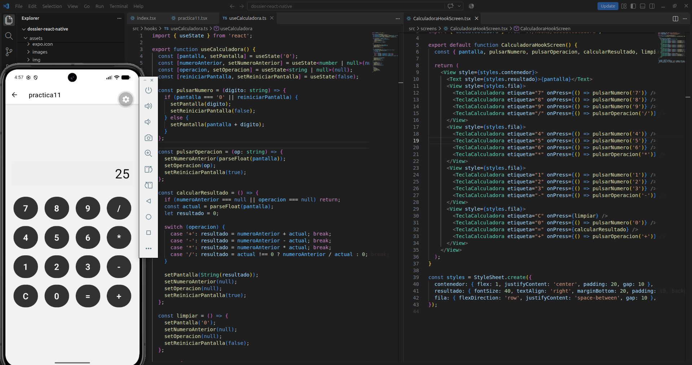

# Dossier de React Native con Expo y Android Studio

### Práctica 1. Hola mundo
Creación del proyecto inicial con Expo y desarrollo de una pantalla básica utilizando `View` y `Text` centrados con Flexbox sobre fondo rosa.

### Práctica 2. Contador con dos botones
Implemento un estado con `useState` para un contador con dos botones (`Button`) para incrementar y decrementar su valor dentro de un contenedor.

### Práctica 3. InicioScreen y estilos separados
Separo las pantallas en la carpeta `src/screens/` (`HolaMundoScreen.tsx` e `InicioScreen.tsx`) y extraigo todos los estilos mediante `StyleSheet.create()`.

### Práctica 4. Tres cajas
Creo el componente `Caja.tsx` en TypeScript y renderizo tres cajas de 100×100 dentro de un contenedor con `flex: 1`.

### Práctica 5. Modificar flex dinámicamente
Uso los estados independientes para modificar la propiedad `flex` de cada caja con botones de incremento y decremento, repartiendo el espacio disponible en la pantalla.

### Práctica 6. Sustituir los botones
Sustituyo los botones por `TouchableHighlight` (mostrando una alerta al incrementar) y `TouchableOpacity` (al decrementar) para mejorar el aspecto visual.

### Práctica 7. Nombre y estilos personalizados
Amplío el componente de caja para recibir estilos externos mediante `StyleProp<ViewStyle>` y aplico bordes y esquinas personalizadas a las cajas.

### Práctica 8. Círculos dinámicos
Genero círculos con colores RGB aleatorios y controles táctiles para alternar entre `flexWrap` (`wrap`/`nowrap`) y `flexDirection` (`row`/`column`).
Añado circulos:

Con nowrap:

En Column:

### Práctica 9. Distribución, alineación e imágenes
Tengo control dinámico de `justifyContent` mediante un `TextInput` validado y de `alignItems` con botones, distribuyendo tres imágenes.

### Práctica 9.1. Imagen aleatoria
Se eligen imagenes aleatorias locales definidas en una colección estática mediante `Math.random()` y se actualiza en pantalla usando `useState`.

### Práctica 10. Calculadora
Desarrollo una calculadora funcional utilizando `SafeAreaView`, botones (`TeclaCalculadora.tsx`), distribución por filas con Flexbox y operaciones gestionadas mediante estados sin usar `eval()`.

### Práctica 11. Hook personalizado para la calculadora
Extraigo las variables y toda la lógica de la calculadora a un hook (`src/hooks/useCalculadora.ts`) y separo el funcionamiento interno de la interfaz gráfica y reutilizo `TeclaCalculadora.tsx`.

### Práctica 12. Color aleatorio con confirmación
Creo una pantalla con un botón que selecciona un color aleatorio de un array y solicita confirmación mediante `Alert.alert()`. Si el usuario pulsa «Aceptar», se actualiza el estado del color de fondo y si cancela, se mantiene el anterior.

